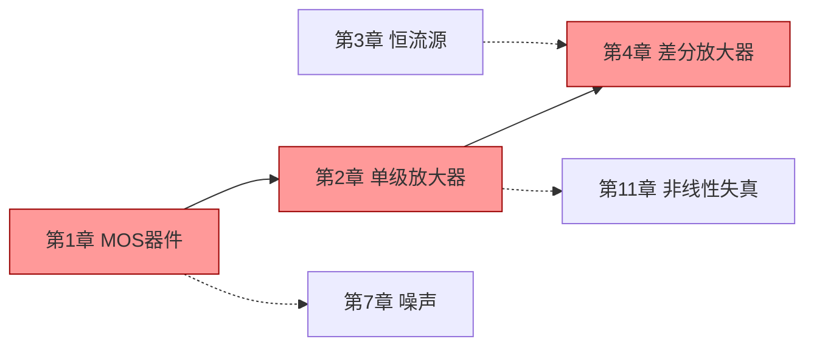

# 输出文档模板规范

## 文件结构

以 webapp 网页端为核心阅读界面。每章生成 3 个精简 MD + 根目录 1 个 data.json。

### 默认方案：3 文件/章 + data.json

| 文件 | 内容（合并来源） |
|------|----------------|
| 讲解.md | 考点清单（★级标注）+ 例题精讲（合并原 01+02） |
| 题库.md | 真题映射 + 自测题（合并原 04+05） |
| 速查.md | 公式手卡（= 原 03，H2 详细块 + 速查表） |

**data.json**：webapp 的结构化主数据源。parser 优先读取，跳过 MD 正则解析。

**MD 默认精简**：不追求 Obsidian 排版（无双链、无 Callout 美化），省 token。用户明确要求「看 MD/打印」时才追加规整排版。

---

## 占位符约定

| 占位符 | 含义 | 示例 |
|--------|------|------|
| `{{科目}}` | 课程名 | "模拟集成电路" |
| `{{章号}}` | 章节编号 | "1" |
| `{{章节名}}` | 章节标题 | "MOS 器件" |
| `{{考点}}` | 具体考点 | "沟道长度调制效应" |
| `{{星级}}` | 重要性 | `★★★` / `★★` / `★` |
| `{{真题ID}}` | 真题题目 ID | "2024B-单选-3" |
| `{{页码}}` | 课本页 | "P55" |

---

## 双链规范

使用 Obsidian 双链建立交叉引用：

```markdown
本考点对应真题 [[04_真题映射#2024B-计算-1]]，详细解法见 [[02_例题精讲#例2.7]]。
```

**链接命名规则**：
- 文件名：`01_考点清单`、`02_例题精讲`...（前缀数字保证排序）
- 章节锚点：用 Obsidian 自动生成的 heading slug（即 # 后的原文，空格转换为 -）

---

## Mermaid 图标准

`00_总索引.md` 必含一张章节关系图：



- 实线箭头：知识依赖
- 虚线箭头：在该章中被复用
- 红色填充：★★★ 必考章节

---

## 答案折叠规范

`05_自测.md` 中的答案必须用 Obsidian Callout 折叠：

```markdown
## 自测 1

题目：求图 1 共栅放大器的小信号电压增益。

> [!faq]- 点击展开答案
> 
> **答案**：$A_v = g_m R_D$
> 
> **解析**：
> 1. 画交流小信号等效电路...
> 2. ...
```

- `[!faq]` 之后必须有 `-`（折叠默认收起）
- 不要用 `<details>` HTML 标签，Obsidian 默认不解析

---

## 公式渲染

- 行内：`$g_m = \mu_n C_{ox} \frac{W}{L} V_{ov}$`
- 块级：`$$ ... $$`
- KaTeX 不支持的 LaTeX 命令（如 `\cancel`）→ 用文字描述
- 矩阵/对齐：用 `\begin{aligned} ... \end{aligned}` 而非 `\begin{align}`

---

## 表格规范

- 每张表必有表头分隔行
- 列数 ≤ 5（移动端可读）
- 公式列允许超长，其他列简洁

---

## 文件命名

```
{输出目录}/
├── 00_总索引.md
├── data.json                  ← webapp 结构化主数据源
├── 01_第1章_MOS器件/
│   ├── 讲解.md                ← 考点清单 + 例题精讲
│   ├── 题库.md                ← 真题映射 + 自测题
│   ├── 速查.md                ← 公式手卡
│   └── _figures/              ← 本章关键电路图（PNG）
│       ├── fig_电路拓扑_xxx.png
│       ├── fig_小信号_xxx.png
│       └── fig_特性曲线_xxx.png
├── 02_第2章_单级放大器/
│   └── ...
└── _extracted/        ← 中间产物（PPT/Word转md），不放最终文档
```

**命名规则**：
- 章节目录前缀使用**课本原始章号**（如 01、02、04、07、11），非连续序号——方便和教材对照
- 格式：`{课本章号两位}_第{N}章_{标题}`（如 `07_第7章_噪声`）
- 不用空格，用下划线
- 不用 emoji（污染 Obsidian 大纲）

---

## data.json Schema

webapp parser.js 优先读取此文件。字段与 `App.state.chapters` 完全对齐：

```jsonc
{
  "version": 1,                      // schema 版本号
  "vaultName": "模集复习",           // 显示在 webapp 顶栏
  "generatedAt": "2026-07-26",       // 生成日期
  "masterIndexContent": "...",       // 00_总索引的 mermaid 原文（供 deps 兜底解析）
  "chapters": {
    "01": {
      "id": "01",
      "slug": "01_第1章_MOS器件",
      "number": 1,
      "name": "第1章 MOS器件",
      "star": 3,                     // 章节重要性 1-5
      "keypoints": [
        {"number": 1, "title": "NMOS/PMOS 工作原理", "star": 3, "body": "markdown..."}
      ],
      "examples": [
        {"title": "例1.1（书本 P55）", "body": "markdown..."}
      ],
      "formulas": [
        {
          "name": "饱和区电流方程",
          "formula": "$$ I_D = \\frac{1}{2}\\mu_n C_{ox}\\frac{W}{L}(V_{GS}-V_{th})^2 $$",
          "condition": "饱和区",
          "note": "萨氏方程",
          "importance": "must",       // "must"|"familiar"|"know"|"normal"
          "meaning": "描述 MOS 管饱和区漏极电流与栅源电压的关系",
          "derivation": "由沟道电荷密度对 V_DS 积分推得",
          "application": "几乎所有放大器增益计算的入口",
          "related": "见 公式 1.2、公式 2.1"
        }
      ],
      "quizQuestions": [
        {"title": "自测1", "question": "题干 markdown", "answer": "答案 markdown"}
      ],
      "examMapping": "真题映射 markdown 原文",
      "deps": ["01"],               // 上游依赖章节 id
      "depTypes": {"02": "tool"},    // dependency | tool
      "files": {                     // 编辑器跳转用
        "讲解.md": "01_第1章_MOS器件/讲解.md",
        "题库.md": "01_第1章_MOS器件/题库.md",
        "速查.md": "01_第1章_MOS器件/速查.md"
      }
    }
  }
}
```
